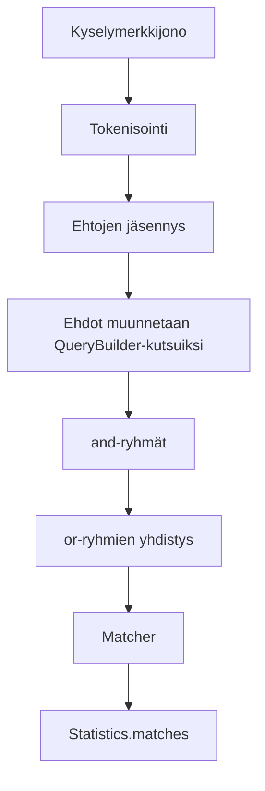
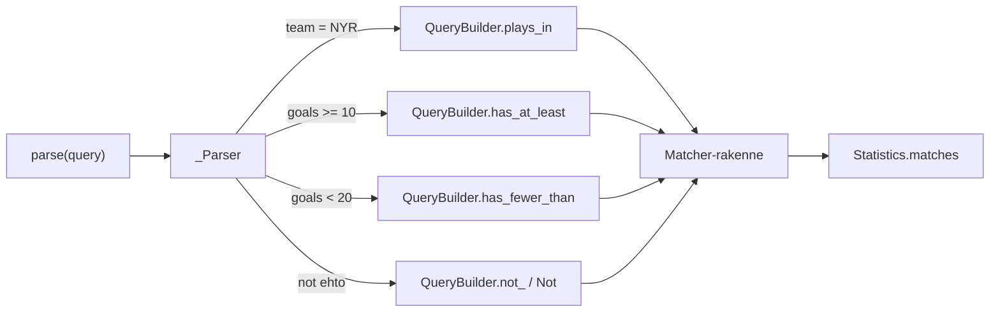

# Kyselykieli

Kyselykielellä voi hakea pelaajia antamalla ehdot merkkijonona. Parseri muuntaa kyselyn matcheriksi, jota voi käyttää `Statistics.matches`-metodin kanssa.

```python
from player_reader import PlayerReader
from statistics import Statistics
from query_parser import parse

reader = PlayerReader("https://studies.cs.helsinki.fi/nhlstats/2024-25/players.txt")
stats = Statistics(reader)
matcher = parse("team = NYR and goals >= 10 and goals < 20")

for player in stats.matches(matcher):
    print(player)
```

Esimerkkikysely hakee New York Rangersin pelaajat, joilla on vähintään 10 mutta alle 20 maalia. Se tuottaa esimerkiksi seuraavat pelaajat:

```text
Alexis Lafrenière    NYR          17 + 28 = 45
Jonny Brodzinski     NYR          12 + 7  = 19
Adam Fox             NYR          10 + 51 = 61
```

## Syntaksi

Kysely koostuu yhdestä tai useammasta ehdosta. Ehdot ovat tällä hetkellä:

| Ehto | Merkitys | Esimerkki |
| --- | --- | --- |
| `team = XXX` | Pelaaja pelaa joukkueessa `XXX`. | `team = NYR` |
| `<attribuutti> >= <luku>` | Pelaajan attribuutti on vähintään annettu luku. | `goals >= 10` |
| `<attribuutti> < <luku>` | Pelaajan attribuutti on annettua lukua pienempi. | `goals < 20` |

Numeerisen ehdon attribuutti voi olla mikä tahansa pelaajaolion numeerinen tai numeerisesti vertailtava ominaisuus, esimerkiksi `goals`, `assists` tai `points`.

Ehtoja voi yhdistää sanoilla `and` ja `or`. Yksittäisen ehdon voi kieltää kirjoittamalla sen eteen `not`:

```text
team = NYR and goals >= 10
team = NYR or team = EDM
not team = NYR
not goals >= 10 and team = EDM
```

Operaattorien etusijajärjestys vahvimmasta heikoimpaan on:

1. `not`
2. `and`
3. `or`

Esimerkiksi

```text
team = NYR and goals >= 10 or goals < 5
```

tulkitaan muodossa

```text
(team = NYR and goals >= 10) or goals < 5
```

Vastaavasti `not team = NYR and goals >= 10` tarkoittaa `(not team = NYR) and goals >= 10`.

Sulkeita ei tueta. Joukkue-ehto hyväksyy vain muodon `team = XXX`, ja muut attribuutit hyväksyvät vain numeeriset ehdot operaattoreilla `>=` ja `<`. Virheellisestä tai tyhjästä kyselystä `parse` nostaa `ValueError`-poikkeuksen.

## Miten toteutus toimii

Julkinen `parse(query)`-funktio on moduulissa `src/query_parser.py`. Se tarkistaa, että syöte on merkkijono, pilkkoo sen tokeneiksi ja antaa `_Parser`-jäsentimen rakentaa matcher-rakenteen.



Jäsennin käsittelee ensin `or`-operaattorin erottamat ryhmät. Kunkin ryhmän ehdot lisätään peräkkäin samaan `QueryBuilder`-ketjuun, jolloin ne muodostavat `and`-ehdon. Useat ryhmät yhdistetään `QueryBuilder.one_of`-metodilla. Näin `and` sitoo `or`-operaatiota vahvemmin. Ehtojen matcherit rakentuvat `QueryBuilder.plays_in`, `has_at_least` ja `has_fewer_than`-metodeilla. `not` käyttää builderin `not_`-metodia ja olemassa olevaa `Not`-matcher-luokkaa.



Jäsennin ei toteuta pelaajien vertailua itse: varsinaisen ehdon tarkistaa matcher, jonka `QueryBuilder` tuottaa. `Statistics.matches` käy pelaajat läpi ja palauttaa ne, joille muodostetun matcher-rakenteen `test` palauttaa toden.

## Testit

Parserin testit ovat tiedostossa `src/tests/test_query_parser.py`. Ne kattavat ehdot, `and`- ja `or`-operaattorien etusijajärjestyksen, `not`-operaation, ympäröivät välilyönnit sekä virheelliset kyselyt. Testit voi suorittaa projektihakemistosta näin:

```bash
PYTHONPATH=src uv run python -m unittest discover -s src/tests -v
```
